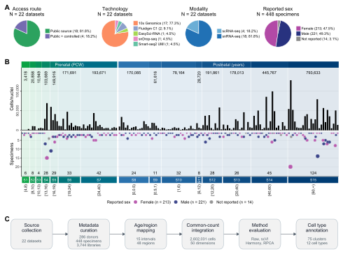

# A human brain single-cell and single-nucleus transcriptomic resource across age intervals

BrainOmicsData provides the code to process, integrate, annotate, and analyze this human brain atlas. The resource includes standardized expression matrices, cell metadata, cell-type annotations, and low-dimensional coordinates for comparing integration methods.

**2,602,031 cells or nuclei · 24,659 genes · 22 source datasets · 75 clusters · 12 cell types**

Download the atlas from [ScienceDB V2](https://doi.org/10.57760/sciencedb.41612). The code cited in the manuscript is [v2.0.1](https://github.com/mengxu98/BrainOmicsData/tree/v2.0.1).

<picture>
  <source media="(prefers-color-scheme: dark)" srcset="figures/fig1-night.svg">
  <source media="(prefers-color-scheme: light)" srcset="figures/fig1.svg">
  
</picture>

## Run the workflow

The numbered workflow covers environment setup, source data download and processing, matrix assembly and integration, figure generation, and local package export.

Set up the [analysis environment](environment/REPRODUCIBILITY.md#environment), run the [software checks](environment/REPRODUCIBILITY.md#software-checks), and prepare the [source data and required inputs](environment/REPRODUCIBILITY.md#workflow-dependencies). List the stages from the repository root:

```sh
bash run_pipeline.sh --list
```

Before running the numbered stages, prepare their required inputs, including the analysis outputs used for figures and export. With no arguments, `bash run_pipeline.sh` runs stages 01–11, ending with a local data package. Select individual stages with `--only`, or a range with `--from` and `--to`.

Use the reproducibility guide to [apply the adopted cell-type labels](environment/REPRODUCIBILITY.md#integration-and-annotation) and run any [standalone downstream analyses](environment/REPRODUCIBILITY.md#downstream-analyses) you need. For cluster jobs, see the [Slurm guide](hpc/README.md).

## License and data use

The code uses the [MIT License](LICENSE).

ScienceDB lists MIT for the integrated V2 resource. MIT covers our own contributions to the integration. All source data and third-party material in the release remain subject to the applicable terms of their original releases. See the [source access table](data/source_access_summary.tsv) and [source-specific redistribution terms](data/source_redistribution_evidence.tsv).
